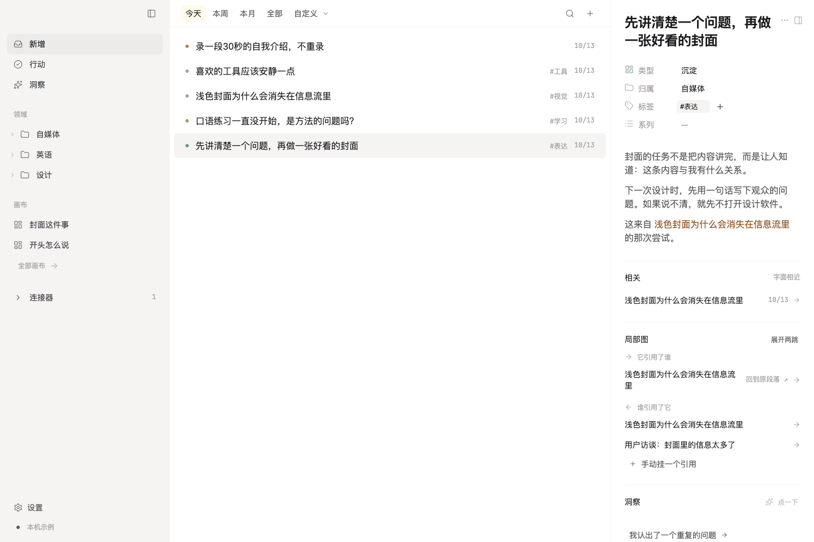

# drill · 深一层

**根据《交给AI.zip》实现的个人知识系统工程版 · v0.1.0 · 2026-10-12**

先捕获，再提炼；用画布组织思考，而不是为整理而整理。



本轮界面改造的设计原则、取舍与后续评审要点见 [界面改造理念](docs/界面改造理念.md)。

## 先看交付状态

这不是只有静态页面的设计稿：共享界面已连接真实 HTTP 服务，服务端合并、桌面 SQLite 和持久化队列有自动化测试。包内也包含 SwiftUI 客户端源码、PostgreSQL 迁移、两种认证／存储适配和部署文件。

截至 2026-10-13，类型检查、Web／Electron 构建、66 项核心回归和 22 项真实 Chrome／Electron 界面验收已通过；界面验收使用临时数据和隔离 SQLite，覆盖内联属性、AI 建议决定、画布节点生长、段落编辑与保存失败后的草稿重试。当前结果见 [界面验收记录](validation/ui-refresh/results.json)。[原验证报告](docs/TEST_REPORT.md) 保留的是较早交付时的环境与结果。

PostgreSQL / MinIO / CloudBase 的生产部署、真实模型调用，以及 iOS 编译、签名和真机性能仍需对应环境验证。桌面打包与签名也不等同于已通过的开发构建。

## 1. 最快体验：不需要安装 npm 依赖

电脑需要 Node.js **22.16 或更新的兼容版本**；本轮核心测试使用 Node 24.19.0。解压后在终端运行：

```bash
cd drill
npm run demo
```

打开 `http://127.0.0.1:8787`。保持终端运行；按 Control+C 停止服务。

这是**仅绑定本机回环地址的体验模式**，有明确的「本机示例 · 非正式数据」标识。示例笔记是虚构内容，保存的操作会写入 `.data/demo/demo.json`，刷新或重启仍保留。第一次启动自动初始化，之后不重复灌入种子。

体验顺序：点右上角 `+` 连续放下几条想法 → 右侧修改类型、归属、标签 → 拖动行动看板 → 打开「封面这件事」画布，拖动卡片、添加临时文字、进入嵌套画布 → 用搜索找回内容 → 看历史版本。

**体验模式不使用 PostgreSQL，也不启用媒体上传、真实 AI 或向量检索。** 它使用预先打包的 React 19 共享界面，只适合本机虚构数据体验。修改界面后先运行 `npm run build:preview` 更新示例资源；正式 Web 构建位于 `apps/web`。

端口冲突时：macOS/Linux 使用 `PORT=8790 npm run demo`；Windows PowerShell 使用 `$env:PORT=8790; npm run demo`。不要通过双击 `preview/index.html` 打开，因为应用需要 HTTP 后端。

## 2. 主要能力

| 入口 | 已写入的功能 |
|---|---|
| 捕获与提炼 | 连续捕获、类型可为空、按类型声明的单选／多选归属、标签、系列、数据库驱动的属性、行动状态、个人记忆适用范围 |
| 上下文栏 | 主体与附文分离、显式引用、外部来源标识、相关内容、版本／丢失值提示；正文完整编辑仅桌面端 |
| 画布 | 自由拖拽、缩放与平移、框选／多选、区域分组、连线、嵌套防环、临时卡片、导图 Tab/Enter 生长 |
| 回看与搜索 | 按捕获时间筛选、时区设置、字面搜索；正式仓库提供 pg_trgm，向量服务配置后开放语义入口 |
| AI | 建议先保存为 proposal，逐条接受／修改／拒绝；洞察只新增 ai_output 和引用，不覆盖原文，证据不足允许沉默 |
| 桌面连接器 | 手动选择的 Obsidian 目录、Chrome History、Codex 会话；只读导入、聚合、来源冻结、变化提示 |
| 同步 | 只有服务端做冲突合并；桌面 SQLite + outbox、幂等重试、段落稳定 ID + 分数索引、墓碑、版本和冲突记录 |

上述能力的不同验证深度与简化边界见 [实现对照](docs/IMPLEMENTATION.md)。媒体、真实模型、云部署和原生外壳仍需在对应环境集成验证。

## 3. 正式工程启动

有网络的开发环境中：

```bash
npm install
node scripts/init-env.mjs
# .env 中保存生成的随机口令；请保密，不要上传。
docker compose --env-file .env -f infra/compose/compose.yml up --build -d
```

上述入口包含本机 MinIO。使用 COS、S3、R2 或已有对象存储时，设置 `STORAGE_DRIVER=s3` 及对应 `S3_*` 配置，改用 `infra/compose/compose.external.yml`，不会启动 MinIO。COS 配置模板见 [cos.env.example](examples/storage/cos.env.example)，完整步骤见 [部署文档](docs/DEPLOYMENT.md)。`AUTH_MODE` 独立选择认证，存储选择不会切换用户身份源。

访问 `http://localhost:8787`，使用 `.env` 的 `AUTH_PASSWORD` 登录。镜像首次拉取、npm 安装、模型下载都需要网络。本环境没有实际执行 Docker 部署，因此这是待集成验收的启动路径，不是已部署服务。

正式发布前运行：

```bash
npm test
npm run check
npm run build
```

首次联网安装后应提交核验过的 `package-lock.json`、审计依赖并在 CI 改用 `npm ci`。当前包含已生成的 `package-lock.json`。

桌面调试：`npm run desktop`。桌面打包：`npm run package:desktop`。未附 DMG、EXE、AppImage 或 IPA，也没有进行应用签名。

iOS：见 [iOS 工程说明](apps/ios/README.md)，使用 XcodeGen 生成工程，再在 Xcode 配置个人签名。完整部署、CloudBase、存储 CORS、开发代理、模型设置和备份说明见 [部署文档](docs/DEPLOYMENT.md)。

## 4. 目录

```text
drill/
├── apps/desktop/          Electron 主进程、预加载桥、SQLite、连接器
├── apps/web/              正式 React 19 + Vite 入口
├── apps/ios/              SwiftUI、Keychain、捕获队列、XcodeGen 配置
├── packages/core/         三端协议中的 TS 数据模型、辅助函数、同步客户端
├── packages/ui/           桌面／Web 共享界面与画布
├── packages/server/       唯一合并实现、HTTP、PostgreSQL、认证、存储、AI
├── infra/                 SQL、同一服务端 Dockerfile、Compose、bge-m3 sidecar
├── preview/               预转译的本机体验资源（不是正式发布包）
├── tests/                 Node 核心／SQLite／HTTP 测试、浏览器脚本
├── validation/            实际测试日志、7 张截图、未通过的类型检查诊断
├── docs/                  原始规格、原参考图、实现／决策／调研／部署说明
└── MANIFEST.sha256         交付文件的 SHA-256 清单
```

**必须先阅读的边界：** [决策与未决项](docs/DECISIONS.md)、[真实验证结果](docs/TEST_REPORT.md)、[上线前验收清单](docs/ACCEPTANCE.md)。
