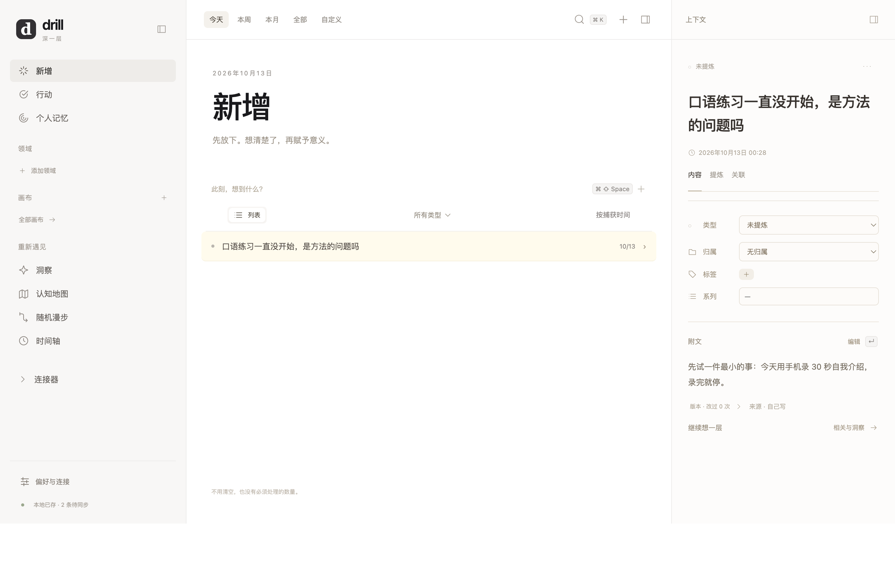

# drill 距离「可用」还差多少 · 实测核查报告

核查日期：2026-10-13 · 核查对象：`/Users/ryanbzhou/drill`（v0.1.0 交付包）
参照：`docs/产品文档.md`、`docs/技术架构.md`、`docs/UIUX设计.md`、`docs/实现提示词.md`，以及 `~/Developer/drill/gap/`（Gap 长跑方法论）

> 本文件是外部核查产物，不属于原交付包，不在 `MANIFEST.sha256` 清单内。

---

## 0. 结论速览

「可用」不是一个门槛，是四个。距离差别极大：

| 目标 | 实测状态 | 距离 |
|---|---|---|
| A. 今天在本机用浏览器体验 | ✅ **现在就能跑** | 0 |
| B. 一个人自己天天用（在电脑上写东西、编辑附文） | ✅ **本报告实测跑通** | 0–2 天（打包成 .app + 备份习惯） |
| C. 正式 Web 端在线用（`npm start` + `npm run build`） | ❌ **构建成功但页面打不开** | 1 行代码 + 一条回归测试 |
| D. 规格里那个三端 + 云 + AI + 媒体产品 | ❌ 缺三大块 | 约 65–100 人日（全职 3–4.5 个月） |
| E. 作为 gap 长期运行系统的方法论载体 | ❌ **规格里根本没有这一层** | 不是工程量问题，是设计问题 |

**一句话**：作为「桌面端个人记录工具」，它比我预期的近得多——我今天把它完整跑通了，捕获、写附文、搜索、重启保留全部可用。作为「你在产品文档里描述的那个产品」，它还有 3–4.5 个月全职工作量。作为「让我在 gap 期长期跑下去的系统」，**当前规格不承载这件事**，见第 4 节。

---

## 1. 我实际做了什么（可复现，全部在本机执行）

| 检查 | 结果 | 关键证据 |
|---|---|---|
| `npm test` | ✅ **47/47 通过** | 与 `validation/node-tests.tap` 一致 |
| `npm install` | ✅ 385 包，8 分钟 | 联网可用，生成了此前缺失的 `package-lock.json` |
| `npm run check`（`tsc --noEmit`） | ✅ **0 错误通过** | 与 `docs/TEST_REPORT.md` 的「未通过」结论相反 |
| `npm run build`（Vite + esbuild） | ✅ 成功 | `dist/` 产物 305 KB JS / 31 KB CSS |
| PostgreSQL 迁移（真库，pgvector 0.8.0） | ✅ 两个 SQL 干净执行 | 20 张表，17 张 ENABLE+FORCE RLS（`users`/`kinds`/`schema_migrations` 除外） |
| 非超级用户连接（`drill_app`，NOBYPASSRLS） | ✅ 正常 | 证明 RLS 不是只在超级用户下跑 |
| 真服务端 `/health`、`/auth/login`、`/bootstrap`、`/sync/push`、`/search`、`/objects` | ✅ 全通 | 真实入库、真实 pg_trgm 检索 |
| 未配置 AI / 向量时的行为 | ✅ 诚实 | `/map` 返回 503「不会用随机图冒充语义结果」，`/insight` 返回沉默 |
| **正式 Web 端在真实 Chromium 里打开** | ❌ **白屏** | 见第 3.1 节 |
| **Electron 桌面端完整闭环** | ✅ **捕获 → 写附文 → 保存 → 搜索 → 重启保留** | 见第 2 节截图，0 控制台错误 |
| `node:sqlite` 在 Electron 38.8.6（Node 22.22.0） | ✅ 可用 | 原报告列为「未验证风险」，已排除 |
| iOS 真编译（`swiftc -typecheck`，iPhoneOS SDK） | ❌ **编译失败** | 5 个错误，全部源于一行；修掉这行后 0 错误 |

---

## 2. 桌面端：实测跑通的完整闭环

用 Playwright 驱动 Electron 38 真跑（`apps/desktop` + `apps/web/dist`）：

```
捕获快捷键 → 写标题            rows-after-capture=1
点「编辑」 → 段落编辑器出现     editor-visible=1
写入附文 → 保存                body="先试一件最小的事：今天用手机录 30 秒自我介绍，录完就停。"
关闭应用 → 重新启动             rows-after-restart=1，附文原样保留
⌘K 搜索                        search-hits=1
控制台错误                      []
```



**这条路径不需要服务器、不需要 PostgreSQL、不需要网络。** 桌面端是本地优先的：SQLite + outbox，联网后才同步。也就是说，只要你想，今天就可以把它当作一个纯本地工具开始用。

这里有一个此前从未被验证过的事实：**桌面端是整个项目里唯一能编辑附文的地方**（`App.tsx:295` 的 `isDesktop() &&` 条件）。浏览器路径一律只读附文。而桌面端在交付时只有「Swift 语法解析 / 未运行 Electron」级别的验证。它今天之所以能跑，靠的是我装上了依赖并真的启动了它。

---

## 3. 三个真实缺陷（按优先级）

### 3.1 正式 Web 端白屏 —— 资源路径撞 API 路由【最高优先级，1 行修复】

`http.ts:94` 的路由正则把**任何以 `/assets` 开头的请求**都当作 API 处理，先要鉴权（`:113`），静态文件处理器（`:96`）永远轮不到。而 Vite 生产构建的默认产物目录恰好是 `/assets/`。

实测：

```
/assets/index-nQeMrZoa.css      未登录 → HTTP 401 application/json
/assets/index-BYXP6ce_.js       已登录 → HTTP 404 application/json   ← 连静态兜底都没有
```

Chromium 里的表现：`Refused to apply style ... MIME type ('application/json')`，JS 同样 401，`<body>` 为空 —— **`npm run build` 成功、`npm start` 起来，但网页是白的**。


为什么没被测出来：唯一那套 23 项浏览器检查跑在 `preview/` 上（用 `/vendor/`、`/apps/` 路径），根本不经过生产构建的 `/assets/`，也不经过真实 HTTP 静态服务。**这是「构建通过 ≠ 能跑」的典型样本。**

修复：给 Vite 设 `base: '/static/'`（或把 API 的资产路由改成 `/assets/*/sign` 之类的精确前缀），再加一条「生产构建能被浏览器打开」的冒烟测试。

### 3.2 iOS 编译失败【1 行修复】

`apps/ios/Drill/DrillApp.swift:67`：

```swift
@State private var url = "", password = "", token = ""   // 属性包装器只能作用于单个变量
```

5 个编译错误（含 `cannot find '$url' in scope` 等连锁错误）。我把这一行拆成三个声明后重新 `swiftc -typecheck`：**0 错误**。

也就是说 iOS 端不是「环境缺失导致没验证」，而是**真的编译不过，而「Swift 语法解析退出码 0」把这个错误漏掉了**。修完这一行、XcodeGen 生成工程、配签名，就能进模拟器——前提是接受它目前只有「拉取/显示/捕获」三件事，且媒体读不出来（`Models.swift` 没解出 `asset_id`）、没有搜索。

### 3.3 语义检索的规模级设计问题【设计级，不是 bug】

`repository.ts:150` 的 `vectors()` 把该用户的**全部**向量 `vec::text` 拉到 Node 里 `JSON.parse`，再在应用层算余弦（`intelligence.ts:12`）。没有 `ORDER BY vec <=> $1`，没有 ANN 索引。

后果：5,000 条 × 1024 维 ≈ 每次查询几十到几百 MB 的 JSON 解析。规格里写的「几十到几百毫秒」在这个实现下不成立。加上没有分块（`chunk_id` 恒为 `'main'`）、内容变了不失效旧向量、只靠手动按钮每次刷 8 条，语义检索这一块是**原型**，不是「差联调」。

另有一处会随时间恶化的：`versions` 表只增不减，而 `/sync/pull` 把全部版本回给客户端（`http.ts:127`），桌面端把它塞进单个 meta JSON —— 用得越久越慢。

---

## 4. 与 gap 方法论的距离（这一节是重点）

你说「按照 gap 期长期运行方法论那个对话来分析」。那我必须把这件事说清楚：**这两个东西目前几乎没有交集。**

Gap 方法论的骨架是四根柱子：节奏、截止、反馈、同伴。我把方法论里每个机制拿去和产品文档对照：

| 方法论机制 | 现在的载体 | drill 产品文档里有没有 |
|---|---|---|
| 季（12 周）/ 退出条件 | `gap/templates/12周计划.md` | ❌（「退出条件」字样 0 次） |
| 周锚点日复盘 | `templates/周复盘.md` + `data/weekly_review.csv` | ❌（「复盘」仅 1 次，且是反面用法） |
| 日/块、MVD | `data/daily_log.csv` | ❌（MVD 0 次） |
| L1/L2/L3 三级证据 | 台账列 + 模板 | ❌（0 次） |
| 去重后新内容口径 | `new_content_delta` 列 + 靠自觉 | ❌（0 次） |
| 累计证据数 | **没有任何文件承载** | ❌ |
| 每周三问 | 模板里的三个空位 | ❌ |
| 对外交付（同伴机制） | 只有计数，没有「给谁」 | ❌ |
| 三个指标看板 | 靠手算 | ❌（而且产品文档 `line 479` 明确用「仪表盘过不了这把尺子」否掉了） |
| 到点提醒 | 手机日历 | ❌（产品文档 `line 429` 明确「不做提醒，那会把回看变成任务」） |

10 条里 9 条为零，剩下 1 条只是「草稿可升版」这种相邻能力。

这不是实现没跟上，而是**产品文档从设计上就把它定位成「输入与提炼的画布」，不是「节律与证据的系统」**。它解决的是「想到什么有地方放、写完能提炼」，不解决「这周有没有产出可证伪的证据」「连续几周没断了」。

而且方法论本身说得很清楚：**没有 L2/L3 证据的一周，只算发生了活动，不算发生了进展。** drill 目前恰好是一个极擅长产生 L1（我记了、我画了、我提炼了）的工具，却没有一处承载 L2/L3。用它替换掉 Markdown 台账，风险是把「感觉在推进」做得更顺手。

### 那这个软件到底值不值得继续投入？

值得的部分（软件明显强于 Markdown）：

1. **去重 + 累计**：`new_content_delta` 记 0 的规则、累计证据数、连续周数、恢复天数，全是跨天扫描和条件判断（blank 不算中断、mvd 不算证据），手算必错——而这是方法论里唯一能挡掉自我欺骗的防线。
2. **跨时间对比**：L2 探测结果与第 0 周基线并排，方法论说「只有重测能给出差异」。
3. **撞见式回看**：认知地图「哪几座山你一直在爬」，这正是你原话里「草稿应该反复回看、不断生长」的正解。
4. **移动端一秒捕获**：你自己在产品讨论里的硬指标。

不需要软件的部分：季初三件事（一页纸沉思，对象化反而更慢）、每周三问（长文本，最怕界面切换）、到点（手机日历就够）。

**所以离「gap 系统可用」最缺的不是功能，是那 5 个字段的累计视图。** 一个只做「块日志 + L2 探测 + 累计/连续/恢复三个数字」的极小页面，比把 drill 补成三端产品对这件事的价值大得多。

---

## 5. 补齐到「规格里那个产品」要多少

我按模块估（口径：一个熟悉 TS/React 的人 + AI 辅助，含联调与验收，不含真机采购等待）：

| 模块 | 状态 | 关键缺口 | 人日 |
|---|---|---|---|
| 同步与合并（`merge.ts`） | **可用** | 冲突 `resolution` 恒为 `lost`；relations 冲突静默丢弃；版本无裁剪 | 4–6 |
| 服务端底座 / RLS / 双后端 | 部分可用 | 迁移无版本门禁；CloudBase 适配器自认未核对 | 5–7 |
| 桌面端（Electron） | 部分可用 | 无打包/签名/自动更新；连接器仅手动；无错误队列修复 UI | 6–9 |
| 画布 | 部分可用 | 工具栏不符规格；无 placement 撤销；大画布未测 | 4–6 |
| 字面搜索（pg_trgm） | 可用 | 中文三元组召回未评估 | 1–2 |
| 语义检索 / 向量 | **原型** | 全量拉进 Node 算余弦；无分块、无增量、无失效 | 8–12 |
| AI 提炼 / 洞察 | 部分可用 | 真模型未联调；`/insight` 自动落库违反规格；无质量评估 | 4–6 |
| 连接器 | 部分可用 | 手动只读、不下载资产、加平台要改服务端白名单 | 5–8 |
| **Web 端** | **打不开** | 3.1 的资源路由冲突 + 真浏览器端到端 | 2–3 |
| iOS | 编译不过 | 修 1 行 + 搜索 + 媒体可读 + 真机冷启动验收 | 6–10 |
| 媒体 / 资产 | 部分可用 | 缩略图与宽高恒 null；无内联图；整文件 base64；无 GC/续传 | 6–9 |
| 回看三发现（地图/漫步/出口） | 骨架 | 地图坐标写死为规则网格；无质量评估 | 5–8 |
| 设计还原度 | 部分可用 | 三栏/令牌骨架在，但整站是暖褐色系，规格要求的是 charcoal/graphite/ash 中性阶 | 3–5 |
| 工程化（E2E / CI / 打包） | 骨架 | CI 从未绿过；无真栈端到端；无打包产物 | 5–7 |
| **合计** | | | **约 65–100 人日** |

其中**撑起「自用可用」的最小集**只有三件：修 Web 路由（1 行）、把桌面端打包成可双击的 app、补一个备份/恢复入口。大约 **2–4 天**。

---

## 6. 建议的路线

- **如果你只是想今天开始用它记东西**：走桌面端。它已经跑通了，而且不需要后端。先跑两周，看它是否真的降低了记录摩擦——这比继续补功能更能说明问题。
- **如果你要的是一个能在线访问的版本**：先修 3.1（1 行），补一条「生产构建能被浏览器打开」的冒烟测试。这一步不做，前面所有验证都不能算数。
- **如果你要的是 gap 长期运行**：不要在 drill 上加节律功能之前先想清楚——按方法论，那 5 个字段先用手写跑满一个 12 周，再决定哪些值得软件化。避免「为了用工具而用工具」。

---

## 7. 诚实声明：本报告没有验证的东西

- iOS 只做到 `swiftc -typecheck`（iOS SDK 下 0 错误，修 1 行后）。**没有链接、没有签名、没有模拟器或真机运行、没有冷启动实测。**
- 没有做多设备同步、冲突、离线的真实联调（两个桌面端 + Web + iOS）。
- 没有在 MinIO / CloudBase 上跑过媒体直传；没有真实模型 API 与 bge-m3 推理质量评估。
- 没有做 1 万 / 5 万对象规模的性能测量。
- 没有做 Electron 打包（`npm run package:desktop`）与签名。
- Docker 未启动（本机 Docker daemon 不在运行）；PostgreSQL 用的是本机 Homebrew 的 `postgresql@16` + `pgvector`。

---

## 8. 我在你的工作目录里改动了什么

为了做实测，产生了以下变化（都不涉及交付源码的修改）：

| 变化 | 说明 |
|---|---|
| `node_modules/`（454 MB） | 联网安装的依赖，装完桌面端就能直接跑。不想留可 `rm -rf node_modules` |
| `package-lock.json` | npm 生成。原包缺失，`docs/TEST_REPORT.md` 说需要联网后补——现在有了 |
| `apps/web/dist/`、`apps/desktop/dist/` | `npm run build` 产物 |
| `.data/demo/demo.json` | `npm run demo` 的示例库（虚构内容）。原本不在包里 |
| `validation/screenshots/verified-*.png` | 本次核查的两张证据截图，未列入 `MANIFEST.sha256` |
| 本文件 | 核查报告，不属于交付包 |

已清理：探针数据库 `drill_probe` 与角色 `drill_app` 已删除；临时脚本、Swift 模块缓存、Electron 下载缓存已移除。**未修改任何交付源码。**
